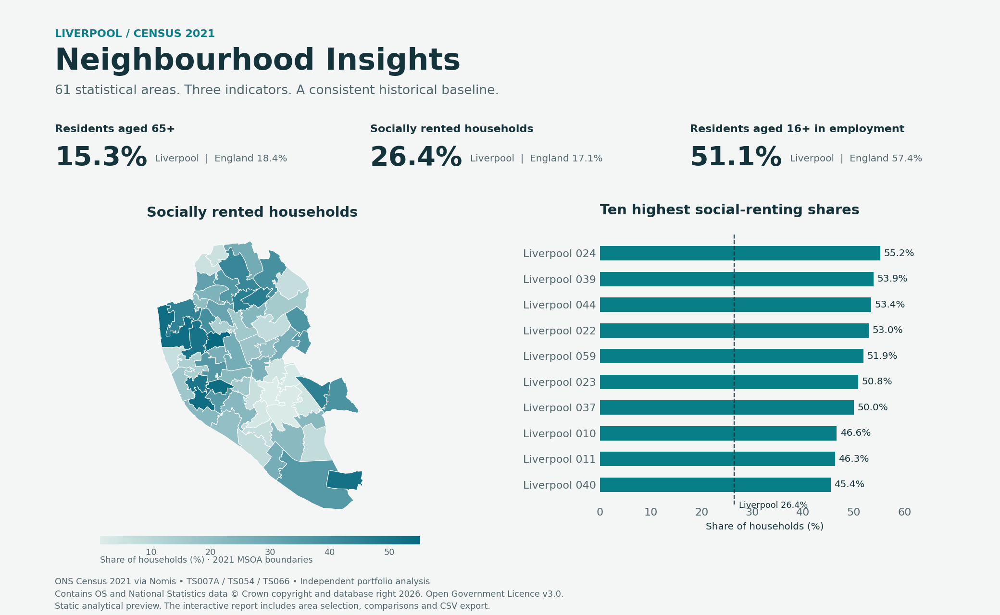

# Liverpool Neighbourhood Insights

**Real ONS data · Python · SQL · Geographical analysis · Power BI**

How did population age, housing tenure and employment vary across Liverpool's 61 statistical neighbourhoods in Census 2021?

This project joins three official Census datasets on consistent **2021 MSOA codes**, calculates rates with explicit denominators and compares each area with published Liverpool and England figures. It includes a selectable offline map, an area comparison page, SQL outputs and a native Power BI project.

**Independent portfolio analysis, not a Liverpool City Council product. Census 2021 is a historical baseline, not a current demand estimate.**



*Static analytical preview from the same checked data, not a screenshot of Power BI or the interactive report.*

## Open the report

1. Download or clone this repository.
2. Open [`reports/dashboard.html`](reports/dashboard.html) in a modern browser. Download the file first; GitHub's code viewer does not execute HTML.
3. Use **Area explorer** for the map, counts and benchmark bars. Use **Compare areas** for rankings, search, sorting and CSV export.

The report is self-contained: no account, Python installation, map API, external assets or internet access is needed to view it. There is no hosted website or analytics tracking.

For Power BI, see [`powerbi/README.md`](powerbi/README.md). The project has two native pages and 13 DAX measures. **Desktop opening, refresh and rendering still need verification.**

## Key findings

| Census 2021 indicator | Liverpool | England |
|---|---:|---:|
| Residents aged 65+ / all residents | 15.3% | 18.4% |
| Socially rented households / all households | 26.4% | 17.1% |
| In employment / residents aged 16+ | 51.1% | 57.4% |

The employment denominator includes retirees and students. It is **not** the standard 16–64 employment rate. Read the [findings](docs/findings.md) for within-city variation and the limits of these comparisons.

## Reproduce the analysis

Python 3.11+; the core pipeline uses only the standard library.

```bash
python analyse.py
python tools/build_report.py
python tools/build_powerbi.py
python tools/build_sql_server.py
python -m unittest discover -s tests -v
```

`analyse.py` verifies the pinned source hashes, validates the extracts, runs the SQL and exports fresh report inputs. It also creates `data/processed/insights.sqlite` locally. The database is generated, not committed. Rebuild the HTML after changing the analysis.

Optional development checks and static preview:

```bash
python -m pip install -r requirements-dev.txt
python tools/check_powerbi.py
python tools/build_preview.py
npm ci --ignore-scripts
npm test
```

To intentionally fetch a new copy of the upstream 2021 sources, run `python tools/fetch_data.py`, inspect the source/metadata diff, and rebuild. This makes network requests to Nomis and ONS's ArcGIS service. Ordinary report viewing and analysis do not.

## What the project demonstrates

- **Matching feeds:** three source tables and official polygons joined by stable area codes, with exact coverage checks.
- **SQL analysis:** constrained source tables, one-to-one joins, correctly weighted rates and percentage-point comparisons.
- **Data quality:** checksums, duplicate/missing key detection, date checks, count validation and an explicit reconciliation of city versus small-area totals.
- **Reporting:** two interactive report pages, downloadable results, native Power BI files and plain-language findings.
- **Judgement:** transparent historical context, correct denominator definitions and no unsupported claims about causation, service need or savings.

## Repository guide

| Location | Purpose |
|---|---|
| `data/raw/` | Small, original-header source extracts, 61 polygons and provenance hashes |
| `analyse.py`, `sql/` | Offline pipeline, SQLite schema/views and standalone SQL Server setup |
| `data/processed/` | Area results, benchmarks, reconciliation, quality and report context |
| `reports/dashboard.html` | Portable two-page interactive analytical report |
| `powerbi/` | PBIP/PBIR report, TMSL model, Power Query imports and DAX measures |
| `docs/` | Requirements, methods, source register, findings and validation status |
| `tests/` | Data-integrity and report-control regression checks |

## Validation and limitations

16 Python tests cover real source controls and failure cases. DOM tests check all 183 area/indicator combinations, navigation, keyboard map selection, sorting, search and CSV export. 22 Power BI JSON files pass Microsoft's public schemas, and visual field references resolve. GitHub Actions runs the data tests, deterministic rebuild checks and report DOM checks.

DOM tests are not visual browser testing. Native-browser rendering, Power BI Desktop execution and SQL Server runtime execution were unavailable during authoring. See the exact [validation record](docs/validation.md) and Power BI opening checklist before describing those environments as tested.

MSOAs are not current wards or the council's 13 neighbourhoods. Census disclosure controls can cause small non-additive totals; these are shown in `reconciliation.csv`, not silently adjusted. Three indicators cannot measure every aspect of an area.

## Sources and licence

[Source register and attribution](docs/sources.md). Numerical data: ONS Census 2021 via Nomis, TS007A, TS054 and TS066. Boundaries: ONS MSOA December 2021 BGC V3.

Code: [MIT](LICENSE). Public data and boundaries: their original Open Government Licence terms. Code and documentation were developed with AI assistance; reproduce and understand the calculations before presenting the project in an interview.
